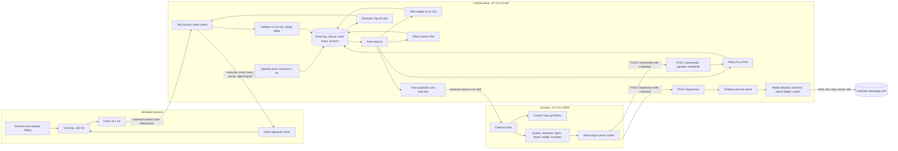

# Architecture plan

Status: Phase 1 plan. No code exists. Checks already run are named as such. Every threshold is a proposed default. Anything that needs a measurement is marked [needs a number].

Imperium: the human control plane for autonomous systems.

## 0. Settled items and items that need a decision

| # | Item | Status |
|---|---|---|
| X1 | Product name | Settled: Imperium. Identifiers use `imperium` (`@imperium/*`, `imperium.asset/1`, `imperium.view/1`, `imperium.log/1`, `IMPERIUM_*`). Affiliation line recommended: "Independent project. Not affiliated with Imperium Defense Group." A company of that name sells unmanned systems and operator tools (name screen, 2026-09-23). Open decision D1. |
| X2 | The brief wants the simulator to publish over WebSocket. Node 22 has a WebSocket client but no server. | Needs approval: `ws@8.21.3` (0 runtime dependencies) and `@types/ws@8.18.1`, for the control plane's source socket only. Fallback without it: NDJSON over HTTP. |
| X3 | Model call path | Needs approval: raw `fetch` (0 dependencies, request shape checked with a keyless 401 probe) or `@anthropic-ai/sdk@0.128.0`. Recommendation: `fetch`. |
| X4 | Terrain against "ask before a Cesium ion token" | Recommendation: tokenless. Fictional procedural terrain, 0 ion requests, proven by a Playwright network test. The token question closes as "not needed" if the owner agrees. |
| X5 | Playwright 1.63.0 needs a browser build that is not cached locally. A download would land outside the repo. | Pin `@playwright/test@1.62.0`, which uses a build already cached. No download. |
| X6 | "Simulator running server-side on Vercel" does not fit how Vercel Functions run (section 9). | Default: recorded replay demo. A live option needs the owner's call. Phase 6 only. |
| X7 | A public push shows the commit author address in history. | The owner decides in Phase 5: keep the global address, or approve a repo-local GitHub noreply address (a git config change). |
| X8 | Figure 1.6 needs real tester data. | The capture script fails loudly on 1.6 until `reports/experiment/results.json` exists. It never uses synthetic data. |
| X9 | Phone view scope | 390 px is read-only everywhere (section 8 of `DESIGN.md`). Each 390 figure has a defined state. |
| X10 | Test runner | `node:test` with Node's built-in type stripping (checked: 1 of 1 `.ts` test passed with no extra tool). Vitest is not needed. |

## 1. Decisions

| Area | Decision | Rejected | Why |
|---|---|---|---|
| Event log | SQLite through `node:sqlite`, 1 file per run, `:memory:` in tests | Postgres (new service and key), `better-sqlite3` (native, unlisted) | Works on Node 22.22.3 without a flag (checked). 1 writer avoids chain forks. Not durable on Vercel, which only matters for Phase 6. |
| Sim to control plane | WebSocket at `ws://127.0.0.1:4100/source`, served by `ws`, a per-run token for each source; a connection speaks only for the source its token names (`docs/policy.md` section 6). The sim uses Node's built-in client. An in-memory loopback runs the same code in tests. | Hand-written RFC 6455 server | Too much risk for no gain. |
| Control plane to console | SSE (`GET /stream`) for `imperium.view/1`, sequenced with `viewSeq`. Commands go browser to console server route to `POST /commands` with the operator credential. | WebSocket to the browser | SSE reconnects by itself and needs no dependency. |
| Operator authentication | Per-run operator credential, held only by the control plane and the console server (policy P4, P22) | CORS only | CORS does not stop non-browser callers. |
| Grant signing | Ed25519 from `node:crypto`. Private key stays in the control plane. The source gets the public key in `welcome`. | Shared HMAC key | A shared key lets the source mint its own grants. |
| Time base | Control plane `clock.tick` at 1 Hz from an injected clock. All timers use `worldNow`. | Frame-driven time only | A silent source would freeze deadlines and liveness alerts. |
| Test runner | `node:test`, `*.test.ts` next to source, Playwright for browser tests | Vitest, tsx | Not needed (checked). |
| TypeScript | `typescript@6.0.3`. Node packages use `module nodenext`, `erasableSyntaxOnly`, `verbatimModuleSyntax`, `allowImportingTsExtensions`, `noEmit`, `strict`, `types: ["node"]`. | TS 7.0.2 | No compiler API. Breaks `typescript-eslint`. |
| Map | `CesiumWidget` (not Viewer), `baseLayer: false`, `skyBox: false`, `skyAtmosphere: false`, `scene3DOnly: true`, `requestRenderMode: true`. Terrain from `CustomHeightmapTerrainProvider` over a shared `heightAt()`. Relief from a 4-step elevation band material plus 50 m contours. Ocean from `globe.baseColor`. A Playwright test asserts 0 requests to `*.cesium.com`. | Ion token and world terrain, Resium, hillshade imagery | Needs approval, shows a default-token credit, and a copied Cesium build trips gitleaks. Resium is unlisted. A continuous hillshade breaks the flat-band contrast table. |
| Scenario location | Fictional islands inside 1 allowlisted open-ocean box. The UI shows local grid km only, never lat and lon. | Any real land, city, border or base | Hard rule 2. Box coordinates are checked in Phase 2 before they are fixed. |
| Model call | `POST /reports/aar` on the control plane, `fetch` to the Messages API with `anthropic-version: 2023-06-01`, model from an allowlist, structured output, `cite-validate` | SDK (pending X3), a Next route (would pull `node:sqlite` into the Next bundle) | `docs/event-log.md`, section 8. |
| Rendering 200 assets | Primitives updated in place outside React: `BillboardCollection` for class glyphs, `PolylineCollection` for trails, routes, uncertainty rings and footprints, `LabelCollection` for exceptions and the selection only. App-level clusters. | Entity API with `CallbackProperty`, `EntityCluster` | Entities rebuild per frame. `EntityCluster` groups by screen distance, not by health. |
| Validation | Hand-written validators in `@imperium/protocol`, with tests | zod and similar (unlisted) | 0 dependencies. |
| Dev orchestration | `pnpm dev` runs `node scripts/dev.ts`: spawns 3 processes, makes per-run credentials, waits for `/health`, shuts all down on exit | `concurrently` (unlisted) | Node built-ins only. |
| Cesium asset copy | `apps/console/scripts/copy-cesium.ts` with `fs.cpSync` on `predev` and `prebuild`. `public/cesium/` is gitignored. | `copy-webpack-plugin`, `cpx2` | Turbopack is the default bundler. A copied build contains a vendor token that gitleaks flags. |

## 2. Module layout and import rules

| Package | Role | May import | Must never import |
|---|---|---|---|
| `packages/protocol` (`@imperium/protocol`) | Wire contract, view contract, `OperatorCommand` union, validators, delta merge, quantize, canonicalize, action catalog, shared thresholds. Browser safe. | nothing | anything |
| `packages/geo` (`@imperium/geo`) | ENU frame, `heightAt()`, allowlisted boxes, polygon and disc geometry, A4 sweep, effect checks (P1, P26). Browser safe, pure. | `@imperium/protocol` | anything else |
| `packages/sim` (`@imperium/sim`) | The autonomy stub: PRNG, ticks, asset classes, scenarios, WebSocket client, loopback, grant signature check | `@imperium/protocol`, `@imperium/geo`, `node:crypto` | `@imperium/core`, `apps/*`, `react`, `next`, `cesium`, `node:sqlite` |
| `packages/core` (`@imperium/core`) | Log, world model, reducer, policy, executor, alerts, commands, view projection, report timeline. `exports` exposes only `"."`. | `@imperium/protocol`, `@imperium/geo`, `node:crypto`, `node:sqlite` (only in `log/store-sqlite.ts`) | `@imperium/sim`, `apps/*`, `react`, `next`, `cesium` |
| `apps/control-plane` | The process: HTTP, SSE, source socket, model route, limits, metrics | `@imperium/core`, `@imperium/protocol`, `ws`, Node built-ins | `@imperium/sim`, `apps/console`, `react`, `next`, `cesium` |
| `apps/console` | Next.js operator console, plus 2 thin same-origin server routes that forward commands and report requests | `@imperium/protocol`, `@imperium/geo`, `react`, `next`, `cesium` | `@imperium/core`, `@imperium/sim`, `node:sqlite`, any `policy/` or `executor/` path |
| `scripts/` | Dev, capture, scans, reports | Node built-ins, `@imperium/protocol`; talks to the stack only over HTTP or the UI | `@imperium/core` internals, `@imperium/sim` internals |
| `tests/` | Acceptance and boundary tests | anything (the lockstep harness must wire sim and core) | nothing |

Enforcement, 4 layers:

1. pnpm isolated `node_modules`: each package declares only its allowed workspace dependencies.
2. ESLint `no-restricted-imports` per package glob, plus `no-restricted-globals` and `no-restricted-properties` for `Date`, `Math.random` and `performance` in `protocol`, `geo`, `sim` and `core`.
3. `tests/boundaries/import-graph.test.ts`: reads every `.ts` and `.tsx` file, extracts specifiers, and checks each edge against the table. It also asserts that the executor exports only `startExecutor`, that no file outside `core/src/policy` imports `grants.ts`, and that the report route imports only `report/timeline` and `report/cite-validate`. Each rule has a failing fixture.
4. The `exports` map on `@imperium/core`: deep imports fail to resolve, and the authority test asserts that.

## 3. Process topology (local)

| Process | Command (spawned by `scripts/dev.ts`) | Binds | Receives |
|---|---|---|---|
| Control plane | `node --disable-warning=ExperimentalWarning apps/control-plane/src/main.ts` | `127.0.0.1:4100` | source token, operator credential, `IMPERIUM_DATA_DIR`, `IMPERIUM_CONSOLE_ORIGIN`, `ANTHROPIC_API_KEY`, `IMPERIUM_MODEL`, limits, `IMPERIUM_RUN_MODE` |
| Simulator | `node packages/sim/src/main.ts --scenario scale-200 --seed 42` | outbound only | source token, control plane socket URL |
| Console | `pnpm --filter console dev` (or `next start` for capture) | `127.0.0.1:3000` | operator credential (server env only), `NEXT_PUBLIC_IMPERIUM_CP_URL` |

- 1 command: `pnpm dev`. `pnpm dev:clean` deletes run logs and anchors first, but keeps `model-ledger.db` and `reports/experiment/`.
- `dev.ts` makes a fresh token for each source and an operator credential with `crypto.randomBytes` per run. None is written to disk.
- It fails fast if port 3000 or 4100 is taken. It kills all 3 children on SIGINT.
- It sets `NEXT_TELEMETRY_DISABLED=1`.

Control plane routes: `GET /health`, `GET /state`, `GET /stream`, `GET /view?atSeq=`, `GET /log?from&to`, `GET /metrics`, `POST /commands`, `POST /reports/aar`. No route can execute an action.

## 4. Dependencies

Every version is pinned exactly. "Listed" means named in the brief's stack or required by a polish-bar item.

| Package | Version | Where | Status | Net benefit | No-dependency alternative |
|---|---|---|---|---|---|
| next | 16.3.6 | console | Listed | App Router console | none |
| react, react-dom | 19.3.0 | console | Listed (Next peer) | UI | none |
| typescript | 6.0.3 | root dev | Listed | Strict type check | none |
| tailwindcss, @tailwindcss/postcss | 4.3.3 | console dev | Listed | Styling | plain CSS |
| postcss | pin at install | console dev | Listed (Tailwind peer) | Tailwind pipeline | none |
| cesium | 1.145.0 | console | Listed | 3D map | none |
| @playwright/test | 1.62.0 | dev | Listed | e2e, perf, capture; reuses a cached browser | none |
| eslint, @eslint/js | 9.39.5 | dev | Listed (polish bar) | Lint; 10.x breaks the Next config's plugin peers | none |
| typescript-eslint | 8.70.1 | dev | Listed (polish bar) | TS lint rules | none |
| eslint-config-next | 16.3.6 | dev | Listed (polish bar) | Next and accessibility rules | none |
| prettier | 3.9.9 | dev | Listed (polish bar) | Formatting | none |
| @types/node | 22.20.4 | dev | Implied by strict TS | Node types | none |
| @types/react, @types/react-dom | pin at install | dev | Implied by strict TS | React types | none |
| ws | 8.21.3 | control plane | Needs approval | Source socket server, 0 runtime dependencies | NDJSON over HTTP |
| @types/ws | 8.18.1 | dev | Needs approval (with ws) | Types | hand-written declaration |
| @anthropic-ai/sdk | 0.128.0 | none | Needs a choice (X3) | Retries, typed responses | `fetch` (recommended) |
| lighthouse | pin at approval | dev | Needs approval (Phase 3) | Scripted, repeatable scores | Lighthouse run through Chrome DevTools, JSON saved to `reports/lighthouse/` |
| @vercel/functions | 3.9.9 | none in MVP | Phase 6 only, needs approval | WebSocket upgrade on Vercel | recorded replay demo |
| resium, vitest, tsx, better-sqlite3, concurrently, cpx2, zod, globals | n/a | none | Rejected | Convenience only | built-ins and hand-written code |

System tools already present, no install needed: gitleaks 8.30.1, ffmpeg 8.1.1 with libx264, libvpx and libvpx-vp9.

Slice S0 checks 3 unverified toolchain details: whether pnpm 10 skips a needed build script (add `pnpm.onlyBuiltDependencies` only if so), whether TS 6 needs a `*.css` declaration for the Cesium widgets stylesheet, and whether Turbopack consumes workspace `.ts` sources through `transpilePackages`.

## 5. Acceptance test matrix

| Criterion or polish item | Evidence file | Command |
|---|---|---|
| Build, 0 errors, 0 type errors | CI log | `pnpm build && pnpm typecheck` |
| Determinism: same seed, identical logs | `tests/acceptance/determinism.test.ts` | `pnpm test:acceptance` |
| Authority: 1,000 requests, 0 without recorded approval | `tests/acceptance/authority.test.ts` (log oracle, mutation guard, credential cases, silent non-compliant stub) | `pnpm test:acceptance` |
| Tamper: 1 edit fails verify | `tests/acceptance/tamper.test.ts` (includes truncation and post-checkpoint rewrite) | `pnpm test:acceptance` |
| Replay at 10 random times | `tests/acceptance/replay.test.ts` | `pnpm test:acceptance` |
| Liveness: a dead source still fires A9 and expires requests | `tests/acceptance/liveness.test.ts` | `pnpm test:acceptance` |
| Pause: no execution while paused, reconnect stays paused | `tests/acceptance/pause.test.ts` | `pnpm test:acceptance` |
| Restart: a grant from before a sim restart never executes | `tests/acceptance/restart.test.ts` | `pnpm test:acceptance` |
| Scale 200: measured frame rate and latency | `tests/perf/scale-200.spec.ts` writes `reports/scale-200.json` | `pnpm perf:scale` |
| Every asset view shows confidence and age | `tests/acceptance/shown-contract.test.ts` (includes cluster aggregates), `tests/e2e/asset-fields.spec.ts` | `pnpm test:acceptance && pnpm test:e2e` |
| Banner on every screen and shot | `tests/e2e/banner.spec.ts` (includes a forced root error and a 404); capture asserts the banner before each shot | `pnpm test:e2e`, `pnpm portfolio:capture` |
| Capture from clean state, every shot, reproducible | `scripts/portfolio-capture.ts` writes `reports/capture-manifest.json` with repo-relative path, size and sha256 | `pnpm portfolio:capture` twice, then compare image hashes |
| figures.json and case study rules | `scripts/portfolio-lint.ts` | `pnpm portfolio:lint` |
| 0 dashes, 0 banned words, sentence case | `scripts/copy-lint.ts` over every tracked `.md`, `.mdx` and UI string | `pnpm copy:lint` |
| gitleaks 0 in tree and history | `scripts/scan-secrets.sh` | `pnpm scan:secrets` |
| Deny-list scan 0 | `scripts/scan-terms.ts` | `pnpm scan:terms` (local only) |
| Privacy scan 0 | `scripts/scan-privacy.ts` over tracked files and history | `pnpm scan:privacy` |
| CI passes on GitHub | `.github/workflows/ci.yml` | `gh run watch` (Phase 5) |
| Polish 1: loading, empty, error on every screen | `tests/e2e/states.spec.ts` | `pnpm test:e2e` |
| Polish 2: 0 console errors, 0 warnings | `tests/e2e/console-clean.spec.ts`. GPU driver messages count as warnings and are reported with the GL renderer string. | `pnpm test:e2e` |
| Polish 3: keyboard and visible focus | `tests/e2e/keyboard.spec.ts` (includes: typing "Please" in the deny reason does not pause) | `pnpm test:e2e` |
| Polish 4: WCAG AA contrast | `scripts/contrast-check.ts` over every token pair in `DESIGN.md` | `pnpm contrast` |
| Polish 5: 1440 and 390 | `tests/e2e/responsive.spec.ts` (`scrollWidth <= innerWidth`) | `pnpm test:e2e` |
| Polish 6: reduced motion | `tests/e2e/reduced-motion.spec.ts` (no running animations, camera still 200 ms after a drag) | `pnpm test:e2e` |
| Polish 7: strict TS, ESLint, Prettier | CI log | `pnpm typecheck && pnpm lint && pnpm format:check` |
| Polish 8: test count and pass rate | `node:test` TAP summary | `pnpm test && pnpm test:acceptance` |
| Polish 9: Lighthouse, top 3 fixed | `reports/lighthouse/*.json` before and after | pending dependency approval |
| Polish 13: no color alone | `apps/console/src/lib/status.test.ts` (status to label and icon map) plus `keyboard.spec.ts` accessible names | `pnpm test`, `pnpm test:e2e` |
| No ion requests | `tests/e2e/no-ion.spec.ts` | `pnpm test:e2e` |
| Import boundaries | `tests/boundaries/import-graph.test.ts` | `pnpm test` |

## 6. Scale plan for 200 assets

Pipeline:

1. The sim steps every 100 ms and emits 1 frame per second: a keyframe every 30 frames, deltas otherwise.
2. The control plane handles each frame in 1 transaction: validate, merge, append 1 `telemetry.frame`, reduce, run effect checks and alerts, append transitions, project. Stage timings are recorded in `apps/control-plane`. Core stays clock-free.
3. SSE sends at most 1 view message per frame per client, with `viewSeq`. Under backpressure the server sends a full keyframe, never a merged delta.
4. The console applies each message to the external store once. Map layers update primitives in place. Panels re-render through selectors.

Rendering:

- "Exceptions first": healthy assets collapse into clusters by group and by 96 px screen cell, recomputed on camera change. Exceptions draw individually with a label.
- Trails draw for exceptions and the selected asset only. "Show everything" draws all 200.
- Positions interpolate for up to 1 s. A `requestAnimationFrame` loop calls `scene.requestRender()` only while interpolation runs. Under reduced motion, positions snap once per frame.
- Capture mode sets `useBrowserRecommendedResolution: false`, so 2x shots stay sharp.
- Picking runs on click or keypress only.

Measurement (`tests/perf/scale-200.spec.ts`):

- Setup: scenario `scale-200`, seed 42, real-time pacer, WebSocket transport, 1440x900, "exceptions first". 60 s warm-up, then a 30 s sample, 3 times.
- Frame rate: `requestAnimationFrame` callbacks per second and Cesium `postRender` events per second. p50 and p5.
- Update latency: `wallSentAtMs` at sim send, to store applied, to the next `postRender`. p50, p95, p99. Valid on 1 machine only.
- Control plane: per-stage ms (validate, append, reduce, alerts, project, broadcast) at p50, p95 and p99 from `/metrics`, view bytes per message, log bytes per frame.
- Context: GL renderer string, headed or headless, Chrome version, CPU model.
- Guard: fails unless at least 600 frames of 200 assets were ingested.
- Report: measured values only. Pass targets are [needs a number] until the first run.

## 7. Capture and experiment plan

Capture (Phase 4):

| Step | Rule |
|---|---|
| Stack | `next build && next start`, `devIndicators: false`, so no dev overlay shows. |
| Clean state | New run directory, `IMPERIUM_RUN_MODE=demo`, scenario `scale-200`, seed 42. |
| Determinism | The sim runs in lockstep to a fixed tick per figure, then holds. The UI shows sim time (`T+00:14:09`), never wall time. Playwright sets a fixed page clock. |
| Operator | Actions come from Playwright clicking the real UI. The run records them as `scripted_operator`, and captions say "demo run". |
| Checks before each shot | Banner text present. No term from the local deny-list (outside git) in page text, `alt` or `aria-label`. No spinner or "Best on desktop" placeholder in a figure. |
| WebGL | Try default headless first. Log `UNMASKED_RENDERER_WEBGL`. Fall back to headed Chrome if rendering fails. Report which was used. |
| Output | PNG at 1440x900 and 390x844, device scale factor 2. Video loops at 1440x900, 6 to 12 s, MP4 (H.264) and WebM (VP9), muted, 4 MB or less each. |
| Review | Open every PNG. Pull 3 frames per video with ffmpeg and open them. Retake any shot with placeholder text, an error, cut-off text or a spinner. |
| Reproducibility | Run capture twice. Image hashes must match. Video hashes may differ, and the report says so. |

Experiment (human-autonomy teaming):

| Item | Plan |
|---|---|
| Scenarios | 2 isomorphic variants, `experiment-01a` and `experiment-01b`: the same 4 problem types (link loss, low-confidence track, GPS fault, 2 conflicting tasks), with different assets, positions and order. |
| Design | Within subjects. Each tester runs both console modes, 1 variant per mode, with mode order and variant pairing counterbalanced. |
| Measures | Time to notice (first `ui.attention` or ack on the problem) and time to decide (the resolving command), in wall time from the `wall_ms` side column. |
| Privacy | Pseudonymous tester ids only (T01, T02, ...). The id map stays outside the repo. Raw sessions are gitignored. |
| Schedule | After Phase 3 passes, before Phase 4 capture. `reports/experiment/results.json` survives a clean run. |
| Reporting | n, raw times per mode, medians. No significance claims. Tester count is an open decision (recommendation: 6 or more). |

## 8. Phase 5 scans

Deny-list scan (`scripts/scan-terms.ts`, `pnpm scan:terms`):

- The deny-list is held by the owner, outside git. Its path comes from `IMPERIUM_TERMS_FILE`, default `.local/terms.txt`. `.local/` is gitignored from the first commit.
- Guards before every scan: the file is ignored by git, is not tracked, never appears in `git log --all --name-only`, and holds at least 1 term. An empty list exits with code 2, never a pass.
- Scope: tracked files at HEAD, `git log -p --all` (includes commit messages), author and committer names, ref names and tag messages.
- Output: location plus term index only, never the term. A history match prints "history match: stop and ask".
- It never runs in CI, because the list is not on GitHub.

Other scans:

- gitleaks, tree: `git archive HEAD | tar -x -C <scratch dir>`, then `gitleaks dir <dir> --redact --no-banner`, so gitignored vendor files are excluded.
- gitleaks, history: `gitleaks git . --redact --no-banner --log-opts="--all"`.
- Privacy: phone, street address, email, coordinates outside the allowlisted box, and absolute home-directory paths on macOS and Linux, and the local account name, over tracked files and `git log -p --all`. Every committed report uses repo-relative paths.

## 9. Phase 6 deploy analysis (no paid service)

Constraints from Vercel's docs (read 2026-09-23): Functions do not share memory and pause between work; max duration is 300 s on Hobby; WebSocket support is in beta, closes at max duration, and a reconnect can land on another instance; SQLite files are not durable; Hobby is for non-commercial personal use with 4 Active CPU hours per month; in-memory rate limits do not hold across instances.

| Option | What runs where | Live server-side sim | New service or dependency | Risk |
|---|---|---|---|---|
| F. Recorded replay (recommended default) | A seeded run is recorded locally, verified, and exported as `view-timeline.json` plus the head hash. Vercel serves the console statically. Approvals are disabled and labeled "Recorded run. Approvals disabled." | No | none | Lowest. Shows no live authority flow, and the label says so. |
| B. Per-visitor live run | 1 Function per visitor runs sim, core and loopback with an in-memory log. SSE to the console. Ends at 300 s. | Yes, up to 300 s | `@vercel/functions` only if WebSocket is used | `node:sqlite` in a Function is unverified. Active CPU per viewer-hour is [needs a number]. |
| C. Time-derived sim with a Postgres log | State rebuilt per request | Yes | external Postgres | Large redesign. |
| D. Vercel Sandbox | Sim in a sandbox | Up to 45 min on Hobby | metered | Not built to host a service. |
| E. Always-on Node host | Sim and control plane elsewhere, console on Vercel | Yes | new host | Best match to the architecture. Needs approval. |
| A. Browser Web Worker | Sim and policy in the browser | No | none | Rejected: policy would share a trust boundary with the UI (hard rule 5). |

Target domain if deployed: `imperium.nate-victor.com`. Nothing in Phase 2 depends on this choice.

## 10. Phase 2 build order

| # | Slice | Ends when |
|---|---|---|
| S0 | Workspace: pnpm workspace, tsconfigs, ESLint, Prettier, CI yaml, empty packages, a console page importing 1 constant from `@imperium/protocol` | `pnpm lint && pnpm typecheck && pnpm test && pnpm build` exit 0. Records where `next dev` writes `AGENTS.md`. Resolves the 3 toolchain checks in section 4. |
| S1 | Protocol types, validators, merge, quantize, canonical, catalog, thresholds | Unit tests pass, including RFC 8785 vectors and 1 failing fixture per V rule. |
| S2 | Event log: store, hash, actor table, anchors, verify, triggers | `tamper.test.ts` passes every case in `docs/event-log.md`, section 7. |
| S3 | Sim core (PRNG, ticks, `det-01`, loopback), ingest, reducer, clock ticks | Telemetry-only determinism passes. Seed 43 differs. |
| S4 | Policy, grants (Ed25519), executor, commands, pause, effect checks | `authority.test.ts`, `pause.test.ts`, `restart.test.ts` pass. The P13 mutation run fails the oracle. Import-graph test passes. |
| S5 | Alerts, selectors, snapshots, `rebuildAt` | `replay.test.ts` 20 of 20, `liveness.test.ts`, alert unit tests, full determinism with the scripted operator. |
| S6 | Control plane process, source socket, SSE with `viewSeq`, `/commands` with the operator credential, `scripts/dev.ts` | `pnpm dev` starts 3 processes. `/health` returns ok. WebSocket-lockstep determinism passes. Credential cases pass. |
| S7 | Console shell after `/impeccable` setup (PRODUCT.md confirmed, concept seed rerun): banner, pause, "Needs you", asset list, 3 states, `global-error.tsx` | `banner`, `asset-fields`, `states`, `console-clean` specs pass. `/impeccable critique` runs at 1440x900 and 390x844. |
| S8 | Tokenless Cesium map: terrain bands, coastline, glyphs, clusters, lines, keyboard | `no-ion` and `console-clean` pass. A screenshot shows terrain and no ion credit. |
| S9 | Authorization queue, inspector, alerts, mission board, health panel | Approve, deny and more-data flows pass. The log oracle is rechecked on that run. |
| S10 | Intent authoring (draw, constraints, permissions, levels, contingency routes) | Intent flow passes. An area outside the allowlist is rejected. |
| S11 | Timeline scrubber and reconstruction | Scrubbed projection equals the `rebuildAt` projection. Pause works from replay. |
| S12 | After-action report | Mocked-fetch tests pass: citation rejection, verb mismatch, forward-looking sentence, cap reached, rate limited, cache hit. Model id re-checked against the deprecations page (Haiku 4.5 retires not sooner than 2026-10-15). Live call only after a key is supplied. |
| S13 | Experiment modes, `ui.attention`, variants 01a and 01b, report script | Script computes both times from a scripted run, labeled "scripted, not tester data", never published. |
| S14 | Scale test at 200 | `reports/scale-200.json` exists with measured values and the GL renderer string. |

After S14 the Phase 2 report goes to the owner: test counts and pass rate from TAP output, plus the scale numbers.

## 11. Known unknowns

- Turbopack with workspace `.ts` sources: untested (S0).
- Allowlisted box coordinates: from memory, checked before they are fixed.
- Headless WebGL on the capture machine: untested.
- Name collisions for Imperium: screened 2026-09-23. 1 company in the same field (Imperium Defense Group). US trademark status in classes 9 and 42: not checked.
- Every threshold, limit and cap is proposed. Every scale and size figure is [needs a number] until measured.
