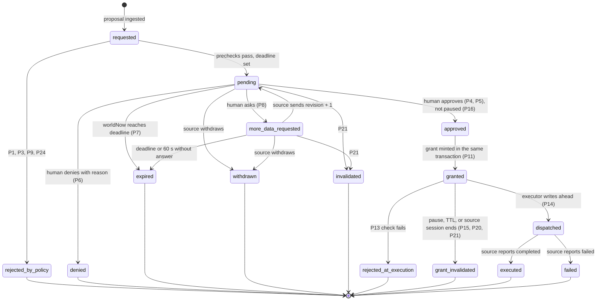

# Policy: autonomy levels, actions and authority

Status: Phase 1 plan. Every time limit and distance is a proposed default for Phase 2 to tune.

Hard rule 5 is the floor: a consequential action executes only after a human approval that the policy service records. No autonomy level, permission, config value or command lowers that floor.

## 1. Autonomy levels

A level is set per group, only by a human, and logged as `group.level_set`. A level controls 2 things: whether routine actions need approval, and whether consequential actions may be requested at all.

| Level | Routine action | Consequential action | Contingency action | Adds to "Needs you" |
|---|---|---|---|---|
| `monitor_only` | Runs and is logged as `action.routine_reported` | Refused at intake: `rejected_by_policy: level_monitor_only`. Never queued, never run. The operator must raise the level first. | Runs and is logged | 0 from requests |
| `approve_consequential_only` | Runs and is logged | Queued. Runs only through a grant after human approval. | Runs and is logged | 1 per pending request |
| `approve_every_action` | Queued, with a 60 s limit. Runs only through a grant. | Queued. Runs only through a grant. | Runs and is logged | 1 per pending request |

```
isConsequential(a)  = catalog(a) === "consequential" || effectIsConsequential(a) || a.sourceHintConsequential
blocked(a, level)   = isConsequential(a) && level === "monitor_only"
                    || permission(a) === "not_permitted"
requiresApproval(a) = isConsequential(a)
                    || level === "approve_every_action" && !isContingency(a)
                    || permission(a) === "requires_approval"
                    || touchesApprovalOverride(a)      // P9, at every level
```

| Rule | Detail |
|---|---|
| Authority | The control plane's commanded level is the authority. `autonomy.levelApplied` is an echo, checked by alert A10. |
| Level changes | Lowering a group to `monitor_only` invalidates every pending consequential request in that group (P21). Raising a level never approves anything. |
| Group membership | Frozen at first registration (protocol V15), with every other descriptor field policy reads (V7, section 6). A source cannot move an asset into a looser group. |
| Contingencies | `contingency.lost_link` and `contingency.energy_return` are declared in the intent. The operator sees their routes at intent authoring (P28), so `intent.upserted` is the recorded human approval. They run without a per-action approval when not paused. They are logged. They are never consequential. |
| Pause | While paused, the only permitted execution is `contingency.pause_hold`. That includes lost-link and energy contingencies (P15). |
| Display | The level shows on every asset (a letter mark on the map glyph and the inspector) and on every group row. |

The level test is table driven: 3 levels x 3 action kinds (routine, consequential, contingency) x 3 constraint states (clear, `approval_override`, `hard`) x 2 pause states. No cell may dispatch a consequential action without an `authz.approved` entry from a human, and no cell may execute anything but `pause_hold` while paused.

## 2. Consequential action catalog

Every action is abstract. Each one resolves as 1 `action.executed {grantId, outcome}` event, and a timed action also gets 1 end event. No action affects any other asset or track. There is no weapon effect and no damage model (hard rule 4).

Deliberately excluded: approaching, following, shadowing or engaging a track, and any track handoff to an outside party. Protocol rule V16 enforces this for routes.

| # | Action | Why it is consequential | Evidence shown | Constraints it can touch | Default limit | Resolves as |
|---|---|---|---|---|---|---|
| C1 | `route.deviate` | Cumulative lateral deviation of more than 150 m from the approved baseline route (P27) | Baseline and new route, reason, position confidence and age, added distance against energy | no-go, operating area, altitude floor, time window | 120 s | `route_changed` |
| C2 | `area.exit` | Leaves the intent's operating area | Exit point, time outside, reason, energy and return time | operating area, no-go, time window | 120 s | `area_exited` |
| C3 | `altitude.below_floor` | Waives the operator's altitude floor | Current altitude and vertical error, requested minimum, duration, terrain height | altitude floor, no-go | 90 s | `altitude_floor_waived`, then `altitude_floor_restored` |
| C4 | `window.extend` | Keeps operating past the operator's time window | Extension length, task progress, endurance against return time | time window | 180 s | `window_extended` |
| C5 | `link.go_silent` | The asset stops reporting, so the operator loses visibility. The card states "Cannot be paused for N s". | Duration, planned path during silence, last position confidence and age, declared lost-link contingency | operating area, time window, no-go (on the planned path) | 120 s | `link_silent_started`, then `link_silent_ended` |
| C6 | `sensor.emit_active` | Active sensing makes the asset detectable | Sensor, duration, the passive track confidence it aims to improve | time window, operating area | 60 s | `emission_started`, then `emission_ended` |
| C7 | `data.release` | Shares 1 survey data package (coverage and sensor health summary, no tracks) with a fictional partner. It cannot be recalled. | Package summary, data age, recipient | none (permission only) | 300 s | `data_released` |
| C8 | `task.preempt` | Takes a task from another asset. This is how autonomy tries to resolve a task conflict (A6), so a human decides. | Both assets' task, progress and ETA, the A6 alert | time window, operating area | 90 s | `task_reassigned` |

- A per-intent `Permission.timeLimitS` can only shorten a limit, within [30, 900] s.
- Routine actions queued under `approve_every_action` use 60 s.

## 3. Authorization lifecycle



| From | To | Actor |
|---|---|---|
| none | `requested` | policy |
| `requested` | `rejected_by_policy` or `pending` | policy |
| `pending` | `approved`, `denied`, `more_data_requested` | human only |
| `more_data_requested` | `pending` (`authz.revised`) | policy |
| `pending`, `more_data_requested` | `expired`, `withdrawn`, `invalidated` | policy |
| `approved` | `granted` | policy, in the same transaction as the approval |
| `granted` | `dispatched`, `rejected_at_execution` | executor |
| `granted` | `grant_invalidated` | policy |
| `dispatched` | `executed`, `failed` | source |

A `grant.invalidated` on a dispatched grant is a revocation (section 6, threat model 3): the request keeps its status, the grant's P26 cover ends at once, and a first execution reported after it is unauthorized (P19).

The words "approved" and "denied" are reserved for humans. Automated outcomes are "rejected", "expired" or "invalidated", and none of them can lead to execution. Expiry never approves.

## 4. Policy rules

| # | Rule | Test |
|---|---|---|
| P1 | Classification. A catalog in `@imperium/protocol` classifies every action type as routine, contingency or consequential. Effect checks in `@imperium/geo` reclassify by effect: a route that leaves the area, drops below the floor, runs past the window, goes silent, switches a sensor to active, or deviates more than 150 m from the baseline is consequential whatever its declared type. The intent area is the operating area: an intent with no `operating_area` constraint gets its area as an `approval_override` operating area whose id is the intent id (geo `intentConstraints`). Sim and control plane import the same code, so the sim knows when it must propose. `sourceHintConsequential` can only add. An unknown type is `rejected_by_policy: unknown_action`. | Reclassification unit tests |
| P2 | Consequential floor. An action that needs approval dispatches only against a grant. The grant references an `authz.approved` entry with actor kind `human` (or `scripted_operator` in a demo or test run), the same `requestId` and `revision`. No level, permission, config or command removes this. | Authority test oracle |
| P3 | Level matrix exactly as in section 1. `not_permitted` gives `rejected_by_policy: not_permitted`. | Level table test |
| P4 | Authenticated human principal. Decisions arrive only through `POST /commands` with the per-run operator credential (see P22). The sim and adapters never receive it. `decide(principal: HumanPrincipal, cmd)` is the signature, and `EventLog.append` checks the actor table at runtime. In `demo` and `test` runs, commands are recorded as actor `scripted_operator`, and the UI and portfolio captions say so. Any other actor gets `command.rejected: not_human`. | Actor table test, forged actors in the authority test |
| P5 | Decision binding. Every decide command carries `requestId`, `revision` and `requestHash`: the SHA-256 of the canonical request snapshot the operator saw (proposal, evidence, constraints touched, effective position radius, deadline). A mismatch gives `command.rejected: stale_request`. The request stays pending. | Stale revision and changed-evidence tests |
| P6 | Deny needs a `reasonCode` from `constraint`, `evidence_weak`, `timing`, `intent_changed` or `other`, plus text of 1 to 500 chars. More data needs an `ask` from the fixed list and a note of 3 chars or more. | Unit |
| P7 | Time limit. `deadline = requestedAt + min(catalogLimit, permission.timeLimitS)`, clamped to [30, 900] s. Checked on every frame ingest and every `clock.tick` against `worldNow`, never with `setTimeout`. At `worldNow >= deadline` the request is `expired`, and the source gets `proposal.decision: expired`. A decision at or after the deadline gets `command.rejected: expired`. | Unit, plus a silent-source test |
| P8 | More data. At most 2 rounds per request. The source must answer with revision + 1 within 60 s, or the request expires. An answer that arrives at or after `answerBy` (or the deadline) expires the request, also between 2 clock ticks. An answer resets `deadline = revisedAt + limit` and gives a new `requestHash`. After 2 rounds only approve and deny remain. | Unit |
| P9 | Intake constraint check. The projected footprint is the path plus an effective radius: `errorRadiusM + (worldNow - position.observedAt) / 1000 * maxSpeedMps`, plus a class margin (alerts A4). Touching a `hard` constraint gives `rejected_by_policy: hard_constraint`. Touching an `approval_override` constraint queues the request at every level with `constraintsTouched` filled in. `errorRadiusM` null gives `position_unverifiable`. A position older than 3E gives `position_stale`. `no_go_zone` is never waivable. The card and the map ellipse show the effective radius. | Geometry unit tests, stale-position fixture |
| P10 | Area allowlist. An intent area and every constraint polygon must lie inside the scenario's allowlisted box. Otherwise `command.rejected: outside_allowlist` (hard rule 2). | Unit |
| P11 | Grant minting. Approval and mint happen in 1 synchronous transaction that first checks `paused` and the deadline. Order: append `authz.approved`, read its `seq` and `hash`, build `{grantId, requestId, revision, assetId, sourceSessionId, actionType, paramsHash, approvalSeq, approvalHash, validUntil = worldNow + 30 s}`, append `grant.minted`. The control plane signs the grant with a per-session Ed25519 private key that never leaves the process. The source verifies with the public key from `welcome`. Seed-derived keys exist only when the run mode is `test`. Live mode refuses them. | Unit, pause injected between steps |
| P12 | The executor's only input is the log tail. It subscribes to appended `grant.minted` entries. It exports only `startExecutor(logTail, transport)`. No function takes a grant from a caller. | Import-graph test |
| P13 | Dispatch preconditions. All must hold: not paused; the grant exists, is unconsumed and was not invalidated; `worldNow <= validUntil`; the entry at `approvalSeq` is `authz.approved` by an allowed actor with a matching `approvalHash`; `paramsHash` matches; the group level is not `monitor_only` for a consequential action; the asset's link is not `lost`; the grant's `sourceSessionId` is the current session; the request is `granted` with this grant as its grant (1 grant per request and revision, P20); the action is not `not_permitted` under the current intents; the P9 re-check against the current intent version and fresh asset state passes; classified again (P1) against the constraints in force and the current baseline route, an action the operator approved as not consequential is still not consequential (`classification_changed`). The executor checks against every committed entry, including those after the `grant.minted` it handles, so a pause committed after the approval refuses the dispatch. Any failure appends `action.rejected_at_execution {grantId, reason}`. | Authority test, red team RT6-21 and NA-08 |
| P14 | Write ahead. The executor appends `action.dispatched` before it sends `action.execute`. If the append throws, nothing is sent. Only the executor builds `action.execute`. | Fault-injection unit test |
| P15 | Pause all. `control.paused` does 5 things at once: the executor refuses every dispatch; every unconsumed grant becomes `grant_invalidated`; every source gets `pause`, and assets go to `held` through `contingency.pause_hold`; request timers keep running; every `proposal.decision` sent while paused carries `apply: "hold"`, so no fallback runs. Lost-link and energy contingencies do not run while paused. No asset leaves the registry while paused: a `registry` that removes one is refused (`source.message_rejected`, rule P15), so every asset stays in view of P18 and P26 until a human resumes. Every asset has a pause point: its position when the pause is committed, or, when it has none then (registered, first reported or re-registered during the pause, or in a run that started paused), its first report with a position during the pause (P26). A pause in force when a run ends (a source restart) carries into the next run: its `run.started` names that pause in `pausedFrom`, the run starts paused, and only a human resume (P17) ends it. | Pause test: deny, expire and invalidate during pause, assert 0 executions and every asset `held`; restart test P1; red team NA-02, RT8-01 to RT8-04 |
| P16 | Approve is refused while paused (`command.rejected: paused`). Deny and more data still work. | Unit |
| P17 | Resume needs a human and `confirm: true` (a 2-step control). It is logged as `control.resumed`. Nothing resumes by itself. After resume, assets leave hold and continue their current task. Fallbacks deferred during pause never run. | Unit |
| P18 | Pause ack, continuous. While paused, any asset that has not reported `held` within max(2 x E, 2 s), or that later leaves `held`, raises A8 (critical). Offline and lost-link assets count as unconfirmed, not exempt. An ack belongs to the session that sent it: after a new `hello` while paused, the source's assets count as unconfirmed until they report `held` in the new session. | Unit, red team NA-07 |
| P19 | Unauthorized execution report. An `action.report` for an action that needed approval, with no matching dispatched grant, appends `action.unauthorized_report`, raises A7 (critical) and marks the asset `compliance: "violation"`. A dispatched grant stops matching when a `control.paused` came after its dispatch (also after resume), when its first execution report arrives more than 5 s after `validUntil`, for a consequential action when its first execution comes while the group is `monitor_only`, and when its first execution comes after the grant was revoked (P21). | Unit with a non-compliant stub source |
| P20 | Replay and stale protection. A grant is single use. TTL is 30 s. At most 1 grant per request and revision. `commandId` is idempotent only for an identical body (the canonical JSON; key order does not count): a repeat returns the first result and appends nothing. A reused `commandId` with any other body gets `command.rejected: command_id_reused` and never answers `applied`. A decision on a terminal request gets `command.rejected: terminal`. | Authority test replays decisions and grants, red team RT6-09 |
| P21 | Invalidation and revocation. These re-evaluate open requests and unconsumed grants: a new intent version, a level change, an asset removal, a source disconnect, a `bye`, A9, and a new source session (only a connection authenticated as that source can open one, section 6). A disconnect or new session invalidates everything open for that source. A hard violation, a `not_permitted` permission, a `monitor_only` level for a consequential request, or a new intent version that changes a constraint the request touched (its definition, its mode, its removal, or an id collision: `constraint_changed`) gives `invalidated`. The same events revoke a live dispatched grant (`grant.invalidated` with reason `level_monitor_only`, `not_permitted` or `constraint_changed`; section 6, threat model 3). Constraint ids are unique across the active intents that share a group, the implicit area id included: an `intent.upsert` that reuses one gets `command.rejected: constraint_id_conflict`. An executed `route.deviate` sets a new baseline route (P27): an open request of that asset that the operator saw as not consequential, and that is consequential against the new baseline, is invalidated (`classification_changed`); P13 refuses the same case at dispatch. | Unit, kill-and-restart test, red team RT6-08, RT6-10, RT6-11, RT6-22, NA-08 |
| P22 | No execute path from the UI. (a) The closed `OperatorCommand` union has no execute member, and the validator rejects unknown types. (b) Control plane routes: `GET /health`, `GET /state`, `GET /stream`, `GET /view?atSeq=`, `GET /log?from&to`, `GET /metrics`, `POST /commands`, `POST /reports/aar`. (c) `POST /commands` and `POST /reports/aar` require the operator credential in an `Authorization` header, `Content-Type: application/json`, an allowed `Host`, and no cross-site `Origin`. The browser posts to the console's same-origin server route, which checks `Origin` and `Sec-Fetch-Site` and adds the credential server side. (d) The `@imperium/core` `exports` map does not expose `executor/` or `policy/`. (e) ESLint `no-restricted-imports` blocks both in `apps/console`. (f) The source WebSocket binds to `127.0.0.1` with a per-run token for each source, which the console never receives; a connection speaks only for the source its token names (section 6). | Import-graph test, fuzz of `{type:"execute"}` and `POST /execute`, and posts with no credential, with the source token, and cross-origin `text/plain` |
| P23 | Model boundary. The report route imports only `report/timeline` and `report/cite-validate`. The `model` actor may append only `report.generated` and `report.rejected`. It has no access to `/commands`. | Actor table test, import-graph test |
| P24 | Fail closed. Any exception during policy evaluation gives `rejected_by_policy: internal_error` and a critical system alert. There is no default-allow branch. | Fault-injection unit test |
| P25 | Simulated sources only. `hello.simulated` must be true (a declaration), and every position must lie in the allowlisted box (the enforcement, protocol V12). | Unit |
| P26 | Effect checks on every frame, every task report and every `clock.tick`. Without a matching active grant, each of these appends `action.unauthorized_effect {assetId, effect}` and raises A7: a position outside the operating area, or a leg between 2 reports at most 3E apart that leaves it; altitude below the floor; operating past the window end (reporting an operating `executionState`, or moving, horizontally or vertically, away from where the asset stood when the window was first seen past its end with no cover, whatever `executionState` says); a footprint in `active` mode; cumulative deviation above 150 m from the baseline route; silence: 1 asset with no fresh report for longer than 3E while its source is connected, or a fresh report that comes more than 3E after the one before it (a report is a frame inclusion with a fresh position observation, or any inclusion for a class that reports no position, so a link-only delta, a null position or an observation sent again does not count; silence is judged on every frame and every `clock.tick`, both on source time, against the source's last `t` carried forward on control-plane time and never against less than the lowest source time the control plane accepts at that moment, and on control-plane time, from the ingest of the frame that brought the last fresh report, so a frozen or slowed `t`, heartbeats alone or frames far apart cannot hide it; a late report is judged once, at the frame that brings it; `registry.removed` is no exemption: the first report after a re-registration is judged against the last report before the removal); a position inside a no-go zone, or a leg between 2 reports at most 3E apart that touches one (`enters_no_go`, never covered); while paused, a position farther than both error radii plus 25 m from where the asset first reported `held`, in the frame that reported it, or from its stop point (its first report observed at or after its stop deadline: the pause-ack deadline after the later of the pause and its pause point's observation), or farther than that plus its stop allowance (its `maxSpeedMps` over the pause-ack deadline plus the age of its report when the pause was committed, that age at most 3E, and 0 for a pause point taken during the pause) from its pause point (P15: where it was when the pause was committed, or its first report with a position during the pause); the allowance is a stopping distance, so it ends at the stop deadline; a climb or descent beyond both vertical errors plus the same margins is movement too, and an altitude that turns known or unknown counts (`moved_while_paused`, never covered); an asset that takes a task another asset holds or last held, in a task report or in its frames (`task_preempted`, covered by `task.preempt` for that task; a task report that rewrites a task another source's assets hold or last held is refused, rule V7). An unknown altitude under a floor that applies counts as below it. Every error radius used as a tolerance, vertical errors included, is capped at the class's A5 critical radius. A cover exists only while its grant is dispatched, unrevoked and not failed, for C3, C5 and C6 until the end is reported, and inside its window: duration or `extendS` plus 5 s (C3 to C6), twice the flight time along the approved path at the class's maximum speed (protocol V3, never the descriptor's own `maxSpeedMps`; at least 1 m/s) plus 5 s (C1, C2; a completion report does not end it), and until `validUntil` plus 5 s (C8). A C1 or C2 grant covers only inside a corridor around its approved path (the position at dispatch, then the waypoints) of the class's A4 margin plus the capped error radius. A C5 grant covers the report that ends a silence only when it lies inside the same corridor around its planned path (the position at dispatch, then `plannedPath`): the part of the gap a C5 covered while it was in force counts as covered only then, so an asset that comes back where the operator did not approve records `goes_silent`. An asset still silent when a C5 cover ends is silent from that moment on, like any asset after a report: it has 3E to report again. A C2 grant covers each area only for twice the length of its approved path outside that area, at the class's maximum speed, plus 5 s, counted from the first check that sees the asset outside it. A C3 grant covers only while the altitude is known and at or above its approved `minAltMslM`. No grant covers a constraint that is hard in force or whose id 2 constraints share. | Silent non-compliant stub that deviates without reporting, red team RT6, round 4 and round 5 (`tests/acceptance/red-team-4.test.ts`, `red-team-5.test.ts`) |
| P27 | Approved baseline route. The control plane stores 1 baseline route per asset: the `plannedRoute` accepted at task assignment, or the route of an executed C1 grant (from the asset's position at dispatch through the approved waypoints; a compliant source flies it). C1 and P26 measure cumulative lateral deviation from the baseline, not from the latest report. Known limit until intent authoring (S10) gives each task an approved route: an asset has a baseline only after an executed C1, so before that a `route.minor_adjust` is judged against areas, floors, windows and no-go zones, not against a baseline (red team D1). | Chain of 100 m adjusts must trigger C1 by the second step |
| P28 | Contingency and fallback bounds. At `intent.upsert`, every `homePoint` of an asset in the intent's groups must lie inside every operating area of the intent (its `operating_area` constraints, or its area when it names none), or the upsert gets `command.rejected: home_outside_area`; contingency routes are drawn in the intent editor. A `proposal.decision` that tells a source to run its fallback authorizes that action, so a proposal `fallback` other than `hold` runs only when the control plane would let it run with no grant right now: it is not consequential (P1, against the constraints in force and the asset's baseline route), it passes the level matrix at the asset's commanded level with the effective permission and the pause state (P3, P15), and it passes P9 touching nothing. Otherwise the control plane sends `apply: "hold"`. | Unit (`policy/constraints.test.ts`, PC-1 to PC-3) |
| P29 | Pause and state on (re)connect. `welcome` carries `paused`, `pausedSinceSeq`, current intents with versions, and group levels. The control plane accepts no frame from a source until that source acks them with status `applied`. While paused, a new session's assets count as unconfirmed (P18) until they report `held` in it. | Test: pause, drop the socket, reconnect, then restart the sim; every asset reports `held` or A8 fires; red team NA-07 |

## 5. Operator commands

```ts
export type HumanPrincipal = { kind: "human" | "scripted_operator"; principalId: Id; sessionId: Id };
export type OperatorCommand =
  | { type: "authz.approve"; commandId: Id; requestId: Id; revision: number; requestHash: string }
  | { type: "authz.deny"; commandId: Id; requestId: Id; revision: number; requestHash: string;
      reasonCode: "constraint" | "evidence_weak" | "timing" | "intent_changed" | "other"; reasonText: string }
  | { type: "authz.more_data"; commandId: Id; requestId: Id; revision: number; requestHash: string;
      ask: "refresh_track" | "sensor_pass" | "health_check" | "explain"; note: string }
  | { type: "intent.upsert"; commandId: Id; intent: IntentSpec }
  | { type: "intent.archive"; commandId: Id; intentId: Id }
  | { type: "group.set_level"; commandId: Id; groupId: Id; level: AutonomyLevel }
  | { type: "control.pause_all"; commandId: Id }
  | { type: "control.resume_all"; commandId: Id; confirm: true }
  | { type: "alert.ack"; commandId: Id; alertId: Id }
  | { type: "ui.attention"; commandId: Id; kind: "alert_opened" | "asset_inspected" | "request_opened"; subjectId: Id }
  | { type: "console.set_mode"; commandId: Id; mode: "show_everything" | "exceptions_first" };
// Closed union. No execute member. The after-action report has its own route (POST /reports/aar),
// which appends report.requested itself.
```

## 6. Threat model and credentials

### Threat model for authority

Every rule in this file serves these 6 statements. The red team tests (`tests/acceptance/red-team*.test.ts`) and the authority oracle test against them.

| # | Statement | Rules |
|---|---|---|
| 1 | Prevention (absolute): the control plane never dispatches an action that needs approval without a recorded human approval, whatever any source, adapter, browser or command sends, and nothing executes while paused except `contingency.pause_hold`. A `proposal.decision` that says to run a fallback counts as authorizing it (P28), and a connection speaks only for the source it authenticated as, so no source can take another source's session, grants or run. | P2, P4, P11 to P17, P20, P22, P28 |
| 2 | Detection (sources are untrusted): for every effect visible in a source's own telemetry (position against areas and floors, time window, sensor mode, silence, task assignment), the control plane appends `action.unauthorized_effect` unless a grant covers that effect right now. A reported state, such as `executionState`, never excuses what the positions show. Movement while paused is detected the same way: every asset in view has a pause point while paused, whenever it first reported, and a stop point after its stop deadline. | P15, P19, P26 |
| 3 | A cover exists only while its grant is dispatched and unended, bounded in time by the approved action and in space by the approved path plus a corridor, and every revocation ends it at once: pause, a level change to `monitor_only`, `not_permitted`, an intent version that changes or hardens a touched constraint, a constraint id collision, or a session change. For C5 the approved path is the planned path: a silence covers the report that ends it only there. | P19, P21, P26 |
| 4 | Descriptor fields that policy reads (`expectedUpdateMs`, `maxSpeedMps`, `homePoint`, `energyKind`, `class`, `groupId`) are frozen at first registration. Silence and staleness are measured against control-plane time, so a frozen source `t` cannot hide them. Silence is judged on the ingest times of the frames that bring fresh reports as well as on source time, so a slowed `t` cannot hide it either. Error radii used for tolerance are capped per class. | Protocol V3, V7, V15; P9, P26 |
| 5 | Commands are idempotent only for an identical body: a reused `commandId` with a different body is `command.rejected: command_id_reused` and never answers `applied`. | P20 |
| 6 | Out of scope, stated as a known limit: a source that consistently falsifies its own reported position. The control plane cannot see past telemetry. | none |

### Credentials

| Credential | Made by | Held by | Never held by |
|---|---|---|---|
| Source token (1 per source) | `scripts/dev.ts`, per run | control plane, that source's simulator or adapter | console, browser, any other source |
| Operator credential | `scripts/dev.ts`, per run | control plane, console server | simulator, adapter, browser |
| Grant signing key (Ed25519) | control plane, per source session | control plane (private), source (public) | log, disk, console |
| `ANTHROPIC_API_KEY` | operator | control plane | browser, simulator, log |

Source identity: the transport maps each source token to its source id and opens the connection with that id (`connectSource(link, { sourceId })`). A `hello` that names another source is refused (`source.message_rejected` rule V1, `reject: unauthorized`), so only a source's own connection can open its session, supersede it, receive its grants or end its run with a lower `t` (protocol section 7).

Known limits: a source that consistently falsifies its own position (threat model 6), an asset with no baseline route before an executed C1 until intent authoring (S10, P27), and local mode trusts the host. Until the source socket exists (S6), the per-source token is a contract on the transport: core binds each connection to the id the transport passes, and cannot check the token itself. The operator credential stops the simulator, adapters, cross-origin pages and unauthenticated local calls. It does not stop a hostile local process that scripts the console itself. The README states both.

## 7. Model boundary (hard rule 6)

The model never approves, denies, plans or executes. It writes summaries of logged events only. See `docs/event-log.md`, section 8 for the report pipeline and citation checks.
